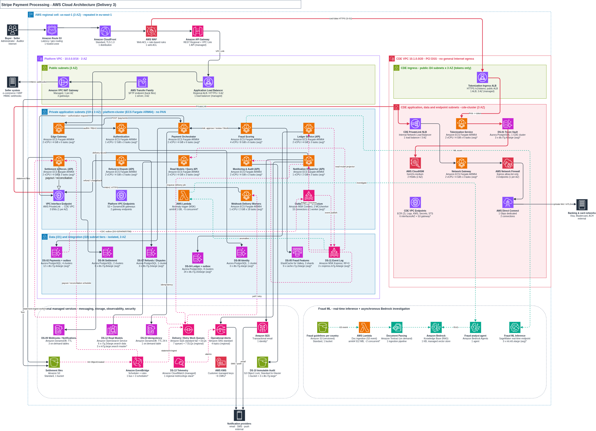

# Stripe Payment Processing
## Delivery 3 — Cloud Architecture & Capacity Plan

Universidad Distrital Francisco José de Caldas  
Systems Engineering — Cloud Computing  
November 2026

## 1. Overview

This delivery presents the cloud architecture and capacity plan for a Stripe-inspired payment processing platform using Amazon Web Services (AWS).

Based on the workload characterization established in Delivery 1 and the logical architecture defined in Delivery 2, this delivery maps the system components to cloud resources, defines their capacity requirements, and evaluates the technical and financial impact of workload growth.

The proposed architecture focuses on:

- High availability and fault tolerance.
- Horizontal scalability.
- Secure payment processing.
- Financial data consistency.
- Real-time fraud detection.
- Reliable asynchronous communication.
- Observability and operational resilience.

## 2. Cloud Architecture

The proposed solution follows a multi-region architecture distributed across:

- **US East (N. Virginia):** 60% of the workload.
- **Europe (Ireland):** 40% of the workload.

Each regional cell is distributed across three Availability Zones and separates general application services from sensitive cardholder data operations through two independent Virtual Private Clouds (VPCs).

- **Platform VPC:** Payment processing, application services, databases, and asynchronous workers.
- **Cardholder Data Environment (CDE) VPC:** Tokenization, sensitive cardholder data storage, and banking network integration.

### Architecture Diagram

## 3. Technology Stack

| Category | AWS Services |
|---|---|
| Compute | Amazon ECS, AWS Fargate, AWS Lambda |
| Relational databases | Amazon Aurora PostgreSQL |
| NoSQL databases | Amazon DynamoDB |
| Caching | Amazon ElastiCache for Valkey |
| Search and read models | Amazon OpenSearch Service |
| Object storage | Amazon S3 |
| Networking | Amazon VPC, Route 53, CloudFront, ALB, NLB |
| Private connectivity | AWS PrivateLink, Direct Connect, Transit Gateway, Site-to-Site VPN |
| Messaging | Amazon MSK, MSK Connect, SQS, SNS, EventBridge, SES |
| Monitoring | Amazon CloudWatch, AWS X-Ray |
| Security | AWS WAF, IAM, Cognito, KMS, CloudHSM, Secrets Manager, Network Firewall |
| Machine learning | Amazon SageMaker, Amazon Bedrock, Amazon Textract |

## 4. Architecture Design

### Compute Design

Amazon ECS with AWS Fargate was selected as the primary compute platform, using ARM64-based containers.

The compute design defines:

- Task specifications and resource allocation.
- Minimum and maximum task counts.
- Horizontal auto-scaling policies.
- Synchronous application services.
- Event-driven workers and batch processing.
- Multi-AZ deployment and fault tolerance.

### Networking Design

The networking infrastructure provides secure connectivity between application services, data stores, and external banking networks.

The design includes:

- Public, private, and isolated subnets.
- Network segmentation between the Platform and CDE environments.
- Application and Network Load Balancers.
- Private service endpoints.
- External banking connectivity.
- Security groups and network access control lists.

### Data Infrastructure

The platform uses multiple managed data services according to the consistency, performance, and storage requirements of each component.

The data infrastructure defines:

- Database instance types and cluster sizing.
- Database sharding and partitioning.
- Caching strategies.
- Backup and recovery mechanisms.
- Cross-region data protection.
- Storage lifecycle policies.

### Communication Infrastructure

The communication architecture combines synchronous service interactions with asynchronous event processing.

Amazon MSK implements the central event log, while Amazon SQS supports background processing, retries, and dead-letter queues.

The transactional outbox pattern is implemented using Amazon MSK Connect and Debezium to support reliable event publication.

### Fraud Detection

The architecture incorporates two complementary fraud prevention mechanisms:

- Real-time fraud scoring using Amazon SageMaker and ElastiCache.
- Asynchronous anomaly investigation using Amazon Bedrock Agents, Knowledge Bases, AWS Lambda, and Amazon Textract.

The asynchronous investigation process remains outside the critical payment authorization path.

## 5. Operations Plan

The operations plan defines the mechanisms required to monitor and maintain the proposed infrastructure.

| Component | Strategy |
|---|---|
| Logging | Centralized application and infrastructure logs |
| Monitoring | Service-specific CloudWatch metrics |
| Alerting | CloudWatch alarms and SNS notifications |
| Health checks | Load balancer and application health checks |
| Distributed tracing | AWS X-Ray |
| Recovery | Automated backups and cross-region protection |

## 6. Security Design

The security architecture incorporates multiple protection layers to support PCI DSS requirements.

The main security mechanisms include:

- Cardholder Data Environment isolation.
- Authentication and authorization.
- Least-privilege access through AWS IAM.
- Centralized secrets management.
- Encryption at rest and in transit.
- Tokenization of sensitive cardholder information.
- Web application and network protection.
- Secure communication with external banking networks.

## 7. Capacity Planning and Growth Scenario

The architecture evaluates the initial workload and a scenario representing a twentyfold increase in demand.

The following values correspond to the primary regional cell in US East (N. Virginia).

| Workload metric | Initial | 20x Growth |
|---|---:|---:|
| Average API requests/s | 3,472 | 69,440 |
| Peak API requests/s | 16,437 | 328,740 |
| Peak write requests/s | 10,684 | 213,680 |
| Peak read requests/s | 5,753 | 115,060 |
| Peak payment creations/s | 3,205 | 64,100 |
| Peak domain events/s | 164,393 | 3,287,860 |
| Budgeted Fargate tasks | 87 | 1,740 |

The growth analysis identifies several capacity requirements:

- Horizontal scaling of application services and workers.
- Database repartitioning and additional Aurora clusters.
- DynamoDB throughput and quota adjustments.
- Expansion of MSK partitions and broker capacity.
- Network capacity adjustments.
- Optimization of monitoring and storage costs.
- Potential activation of an additional Asia-Pacific regional cell.

## 8. Cost Analysis

The infrastructure costs were estimated using the AWS Pricing Calculator for both workload scenarios.

| Scenario | Estimated monthly cost (USD) |
|---|---:|
| Initial workload | $418,921.92 |
| 20x growth workload | $6,595,033.10 |

The estimated infrastructure cost increases by approximately 15.74 times under the 20x workload scenario.

Database infrastructure, particularly the financial ledger, represents the main cost driver.

### AWS Pricing Calculator Estimates

- [Initial Workload](https://calculator.aws/#/estimate?id=ee2e6c10e112f4131143acb3277d87e005d7ebd7)
- [20x Growth Workload](https://calculator.aws/#/estimate?id=5d3467a190b1abdaa7c3b3aed58cd0dcc69523e8)

> The cost estimates correspond to US East (N. Virginia) and represent a preliminary regional infrastructure budget. Additional production regions, disaster recovery resources, and selected complementary services are not included.

## 9. Deliverables

| Deliverable | Description |
|---|---|
| Delivery 3 Report | Complete cloud architecture and capacity plan |
| Cloud Architecture Diagram | AWS infrastructure and component interactions |
| Compute Diagram | Compute resources and scaling configuration |
| Networking Diagram | VPC structure and network connectivity |
| Communication Diagram | Synchronous and asynchronous interactions |
| Initial Cost Estimate | AWS Pricing Calculator baseline scenario |
| Growth Cost Estimate | AWS Pricing Calculator 20x workload scenario |

